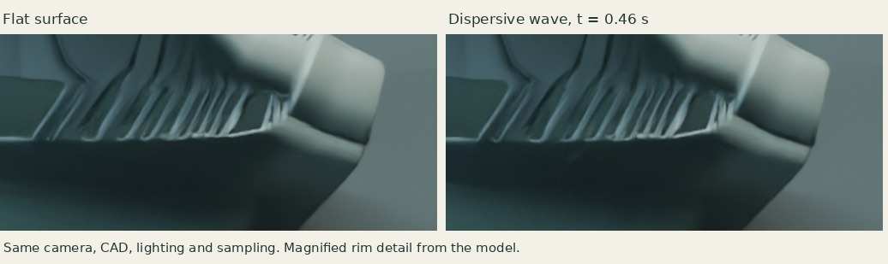

# Looking at the lip

The 2025 tank recording already provides stronger evidence of separation than a synthetic birth would. The optical studies ask a narrower question: how much evidence of disturbed water can be seen on the contours of the later CAD proposal? The shell stays fixed. Deformation of its image comes from changing surface slope and refraction.

## Two experiments

The first wide pass uses a travelling, diminishing wave around the joined project head and tail. The released-light highlight at the bottom originally resembled a third object. A tighter crop removes the visible edge of the water plane, but a light patch remains. This makes the wide shot a poor choice to stand in for a birth. [Four-second optical rush](../media/water-surface-rush.mp4) · [four reviewed frames](water-surface-review.jpg)

The close pass constructs the two print meshes in metres, assembles them at their docking faces and places them in a bounded water volume. A 1.34 × 0.76 m rectangular study tank with 0.275 m depth is assumed for this optical test. These are different dimensions from the gallery mock-up. A small initial disturbance is centred just ahead of the modelled mouth. The camera and the shell stay fixed. Length scale and refraction are modelled; light strength, background, surface finish and loss rates are study settings.

The surface uses a cosine expansion with reflecting rectangular walls. Each mode has squared angular frequency (g k + σ k³ / ρ) tanh(k h), with g = 9.81 m/s², σ = 0.072 N/m and ρ = 998 kg/m³. A zero mean mode preserves the volume. Measured maxima from the model are +4.20 mm at the start, +0.69 mm at 0.5 s and +0.30 mm at 4 s. The solution spreads and reflects the disturbance; a constant-speed concentric pattern misses that behaviour. The mesh of the hull is an optical occluder. Hydrodynamic scattering from the hull, contact-line pinning and fluid–structure feedback are outside this model. [MIT wave notes](https://web.mit.edu/fluids-modules/waves/www/material/chap-3.pdf) · [surface implementation](../production/wave_tank.py)

At model time 0.458 s a control render held the surface flat, with matching camera, CAD, light, sampling and image denoising. In a 345 × 155 pixel rim crop, mean absolute difference across display colour channels was 1.82/255 and the 95th percentile was 7/255. An upper-left static area averaged 0.036/255. The clearest difference is at the right lip and the bases of the grooves. These are image differences in one simulated setup. They cannot establish the visibility of a real pulse or validate actual fluid velocity. At the scale of the full room the effect can be missed.

The plate and moving studies use Blender Cycles. Early builds lacked integrated denoising. The finished optical rush uses Intel Open Image Denoise on rendered frames, followed by a 4% blend of original samples. Documentary footage does not pass through this treatment.

## Motion reviews

The [wide view](../media/water-surface-rush.mp4) contains 96 consecutive rendered frames. The [close lighting test](../media/rim-lighting-rush.mp4) contains 24 consecutive frames. The [bounded dispersive surface](../media/dispersive-rim-rush.mp4) contains 36 consecutive frames, 1.5 s at 24 fps. Only the last example uses the finite-depth mode calculation. Its native 720 × 405 picture is padded by one scan line for H.264. Compare the [six sampled images](dispersive-review.jpg) with the flat-surface control above. The difference reads at the lip; the documentary shot remains much stronger for seeing the motion of the two bodies.

The [frame ledger](render-ledger.csv) records completion times, hashes and Blender render time for the 156 frames in the three rushes, plus the matched control and six gallery renders. The median frame times were 13.29 s for the wide test, 64.83 s for the close lighting test, and 25.64 s for the dispersive test. Jobs overlapped. Summing these times would overstate elapsed work.
