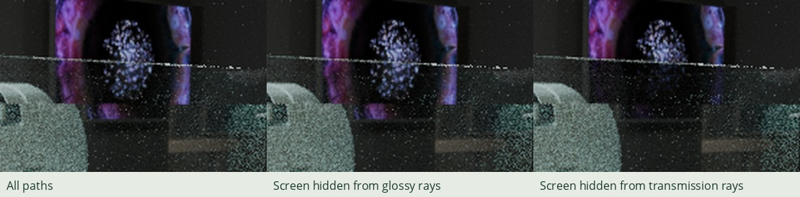

# What moves behind the front pane?

The most distracting light near the stationary shell comes through the glass. For this seated view the digital population sits behind the tank on the north wall. In the model, hiding the digital image from glossy reflection rays scarcely changes the bright group below the rail. Hiding it from transmitted rays removes much of that group. Above the rail one can still see the screen directly. Moving the screen can clear a visual overlap that a more matte surface on the cabinet would leave in place.

The [four-second comparison](../media/population-on-glass.mp4) uses the artist’s *Water Beings* recording from 49 to 53 s. The north- and east-wall screens show the same 64 samples at 16 fps. The shell, water surface, tank light and seated eye are fixed. The room uses its revised service bench. The north film wall holds the open-caption documentary frame at 49.5 s. In each column the upper picture shows the full camera field and the lower picture enlarges the same 320 × 180 region. This is a gallery optical simulation; the actual robotic hull filmed in the main work has another shape.

Across a 6,241-pixel region on the upper right of the projected front pane, hiding the screen from camera rays changes mean absolute display luma by 0.033 levels, and hiding it from glossy rays by 0.002. Hiding it from transmitted rays changes the same patch by 9.424 levels. On a patch just above the rail, hiding it from camera rays changes the mean by 28.08 levels. The visibility changes are path-tracer diagnostics and cannot be performed with a switch in a physical exhibition. The three optical paths need not sum independently under multiple scattering.

Across 63 consecutive frame transitions, the corresponding mean step inside the upper-right pane is 2.166 code levels in the north trial and 0.074 in the east trial. At the centre of the static shell it is less than 0.002 in both. Holding the source texture on its first image at render frames 1 and 8 produced identical RGB pixels. Quantities were taken before denoising, with a fixed render seed. The review movie uses the denoised pictures. Blacking out an entire screen also alters the illumination and sampling in the room, so that test alone cannot identify the optical path. [Visibility checks](population-paths.csv) · [Motion samples](population-motion.csv) · [Frame writes and hashes](population-frames.csv)

At the venue, stand at the bay with the physical tank paused. Show a moving population, then a held frame. Mask the screen sightline behind the tank with a temporary dark panel while leaving the tank’s side light on. Compare both eye heights and the view above the rail. Then try the second screen position and walk the turn between it and the tank. Real glass, water, a different mount and an occupied room may put the image elsewhere. This test establishes a physical source for an apparent movement before anyone attributes it to a sensor or a living response.
