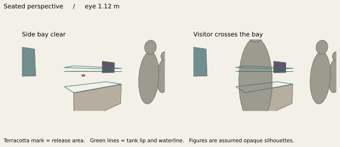

# Rehearsing a visitor's place at the tank

This working drawing assumes an 8 × 6 m room and proposes a 1.8 × 0.65 m tank envelope. Measure the venue, cabinet and waterline before specifying furniture. The separate staff bench keeps the wet reset route behind the tank. The projected population can continue while the live tank rests. The film screen carries a permanent “Recorded tank studies / Water Beings simulation” legend. The film has its own clock.

| Walkthrough | Timeline or geometric test | Outcome in the drawing or edit |
|---|---|---|
| Arrive mid-loop | Enter at film 31 s. Watch about 1 s to see the first body clear the rim, then 9 s to the second prototype. On a 20 s visit, reach the digital return. | A viewer sees two distinct tanks with no introduction. Add permanent object labels with stills of both prototypes next to the screen; label the digital work by title. |
| Arrive after release | Enter at 48.2 s. Stay 25 s. Encounter the returning digital population, the loop splice and the early tank take. | The visitor can leave before the next release. Display the complete loop duration and give a seat alongside the accessible bay. Avoid a countdown that promises a live event. |
| Seated / standing | Project the seated bay’s plan ray into section. Its horizontal run to the release is 1.78 m. It reaches the front glass 82.8% of the way there. At eye heights 1.12 and 1.62 m the corresponding ray heights at the front glass are 1.037 and 1.123 m. | Both pass above the proposed 0.68 m opaque plinth and below the 1.24 m top rail. The standing ray is close to the 1.13 m waterline: conduct an actual glare/refraction test and move the standing mark if needed. Treat these as dry straight-line calculations. |
| Four standing, one seated, one arriving | Place four 0.42 m discs at the marked group positions. Sight ray from the lateral bay at (2.55, 2.45) to (3.50, 3.96) never crosses their occupied x-range ≥4.24 m. Walk the sixth person along the south bypass. | Clear in this arrangement. A visitor standing at (3.0, 3.15) would obstruct the ray. Move group orientation sideways; use floor marking and attendant observation. Tape wheelchair turning and exit routes at full scale. |
| No touch, silent | Mute the 56 s file and review the frame sheet. The first body emerges over the course of one continuous shot, and the second tank's glass edge stays visible. | A viewer need not touch anything or hear a cue to perceive release. Without labels the change in tank could read as a reverse angle. Keep both prototypes named on the wall. |
| Pump stops during a visit | Tabletop scenario: at 0:00 stop the live apparatus; at 0:15 post “Live tank paused”; at 0:30 allow viewing of the independent 56 s film. At 2:00 the operator is still inspecting. | No missed restart deadline. The host keeps the bay available. The operator records fault and actual restoration time; leave the notice in place until a supervised cycle succeeds. Film playback never substitutes for the live status indication. |

## Build and staff test

Black out the film wall first. With the tank lights on, bring up the brightest digital frame and step through the seated and standing marks. Flag any screen reflection over the release point. Try a hooded directional display on the left if projection cannot be isolated. Keep path and edge lighting available throughout. Stand at the door with pump only, film only and both running. Check whether visitors can converse and hear the host; reduce playback spill before increasing gain. Keep amplification mechanically separate from the tank stand.

One trained operator needs access to drain, top-up, dry tools, replacement child and priming supplies. A host is needed during crowded resets unless the gallery can cover visitor routing from its floor staff. Agree handoffs, breaks and shutdown authority before opening. Confirm loaded weight, floor capacity, power protection, service access and venue water procedures with the installation team. Run several complete supervised cycles, time retrieval, loading, priming and release separately, and write the median and longest reset on the operations sheet. The proposed dimensions, visitor paths and sample interruptions above were tested on paper and against encoded images; no audience observations or measured pump recovery times are claimed.

Witness, A Stranger and The Night Shift remain possible alternatives. This plan tests whether a visitor can move from encounter to sustained observation to an account of care while also leaving after any one of those experiences. The mock-up can fail that test.

A second geometry check projects the same room from the seated eye toward the proposed release location. Four marked standing positions intercept zero centre sight rays; a fifth person stepping diagonally into the bay intercepts one. This is a pinhole view and a centre-line intersection against assumed opaque bodies. Test the effect of heads, the tank rim, reflections, different chair heights and real turning space in the venue. [Reproducible calculation](../production/sightlines.py)

### How often would someone actually see the release?

For a uniform arrival around a 56.2 s film loop, a visitor staying 20 s has about a 36% chance of seeing the first prototype's single separation instant. A 10 s visit has about an 18% chance. These are exact window/period ratios under the stated arrival model; real dwell times need observation. The 79.15 s exhibition edit lowers the corresponding 20 s probability to about 25%. Its bench sequence gives those visitors another event to encounter. Ask someone who saw only the pump test what relation they think it has to the tank. A second screen repeating the climax could improve coverage while reducing the value of the wait; test this as a curatorial choice.

### Two possible playback positions

The plan offers a testable acoustic choice. With identical direct sound at the seated listener, how much reaches the entrance? Coordinates below use metres in the same 8 × 6 room. The assumed entrance listener is at (0.45, 0.64, 1.50) and the seated ear is at (2.55, 2.45, 1.12).

| Playback source | Distance to seated ear | Distance to entrance | Predicted direct level at entrance relative to seated ear |
|---|---:|---:|---:|
| At the film display, (1.40, 5.80, 1.485) | 3.56 m | 5.25 m | −3.4 dB |
| Small speaker on a separate stand outside the bay, (2.35, 3.55, 1.05) | 1.12 m | 3.50 m | −9.9 dB |

The comparison uses 20 log10(seated distance / entrance distance) for a free-field point source. It gives a reason to test the nearer position: about 6.5 dB more direct-sound separation for the same level at the seat. It does not predict the installed sound level. Reflections, low-frequency room modes, source directivity and other visitors are absent. Bring both positions up to the same measured level at the seat. At the entrance, compare intelligibility and recorded level against pump-only background. Check the standing group and the live operator as secondary listeners. Keep the stand, cable and its base clear of circulation and outside the taped turning circle. A quiet or caption-only presentation remains available. [Acoustics Lab, direct and reflected sound](https://acousticslab.org/RECA220/PMFiles/Module07.htm)

### Camera rehearsal of the proposed room

[Open the six switchable views](room.html#sightline-trials). The room uses the plan coordinates, two true-scale project STL meshes, a 9 mm modelled glass front pane, a nominal 1.13 m waterline and film frames on emissive display surfaces. The mouth of the 390 mm head faces the lateral bay. The 1.12 m and 1.62 m eye positions share the same plan mark. Neutral human-sized volumes stand in for visitors. Their posture and behavior have not been observed.

In the first test, the bright digital image at the right crosses the outline of the tank. Through the seated view, a clear line to the mouth therefore still competes with another image. The fifth standing position blocks most of the carrier. The lighting variant changes both the liner and the cross-light. It brightens the lower tank, but leaves the north-wall image in the glass. In the last test the digital image moves to the east wall, centred at (7.88, 4.85, 1.46); both the material and the seat stay fixed. Compare the right-hand pane. A person now needs to turn farther to see the digital image. Mark both wall options on site before fixing the projector position.

These are ray-traced design comparisons with approximate transmission lighting. They do not measure venue illuminance, contrast through actual glass, wheelchair access or crowd behavior. The printable north elevation describes the baseline candidate. The east-wall image is a separate test.
