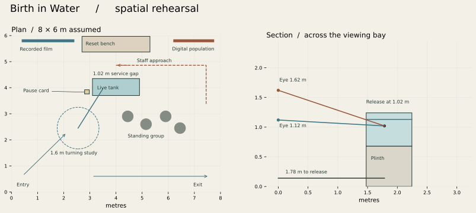

# Rehearsing a visitor's place at the tank

This working drawing assumes an 8 × 6 m room and proposes a 1.8 × 0.65 m tank envelope. Measure the venue, cabinet and waterline before specifying furniture. The separate staff bench keeps the wet reset route behind the tank. The projected population can continue while the live tank rests. The film screen carries a permanent “Recorded tank studies / Water Beings simulation” legend. The film has its own clock.

| Walkthrough | Timeline or geometric test | Outcome in the drawing or edit |
|---|---|---|
| Arrive mid-loop | Enter at film 31 s. Watch about 3 s to see the first body clear the rim, then 9 s to the second prototype. On a 20 s visit, reach the digital return. | A viewer sees two distinct tanks with no introduction. Add permanent object labels with stills of both prototypes next to the screen; label the digital work by title. |
| Arrive after release | Enter at 48.2 s. Stay 25 s. Encounter the returning digital population, the loop splice and the early tank take. | The visitor can leave before the next release. Display the complete loop duration and give a seat alongside the accessible bay. Avoid a countdown that promises a live event. |
| Seated / standing | Section assumes front glass at 2.20 m and release at 2.60 m. Draw lines from x=0.45 m at eye heights 1.12 and 1.62 m to z=1.02 m. At the front glass they pass at 1.039 and 1.132 m. | Both pass above the proposed 0.68 m opaque plinth and below the 1.24 m top rail. The standing ray is close to the 1.13 m waterline: conduct an actual glare/refraction test and move the standing mark if needed. Treat these as dry straight-line calculations. |
| Four standing, one seated, one arriving | Place four 0.42 m discs at the marked group positions. Sight ray from the lateral bay at (2.55, 2.45) to (3.50, 3.96) never crosses their occupied x-range ≥4.24 m. Walk the sixth person along the south bypass. | Clear in this arrangement. A visitor standing at (3.0, 3.15) would obstruct the ray. Move group orientation sideways; use floor marking and attendant observation. Tape wheelchair turning and exit routes at full scale. |
| No touch, silent | Mute the 56 s file and review the frame sheet. The first body emerges over the course of one continuous shot, and the second tank's glass edge stays visible. | A viewer need not touch anything or hear a cue to perceive release. Without labels the change in tank could read as a reverse angle. Keep both prototypes named on the wall. |
| Pump stops during a visit | Tabletop scenario: at 0:00 stop the live apparatus; at 0:15 post “Live tank paused”; at 0:30 allow viewing of the independent 56 s film. At 2:00 the operator is still inspecting. | No missed restart deadline. The host keeps the bay available. The operator records fault and actual restoration time; leave the notice in place until a supervised cycle succeeds. Film playback never substitutes for the live status indication. |

## Build and staff test

Black out the film wall first. With the tank lights on, bring up the brightest digital frame and step through the seated and standing marks. Flag any screen reflection over the release point. Try a hooded directional display on the left if projection cannot be isolated. Keep path and edge lighting available throughout. Stand at the door with pump only, film only and both running. Check whether visitors can converse and hear the host; reduce playback spill before increasing gain. Keep amplification mechanically separate from the tank stand.

One trained operator needs access to drain, top-up, dry tools, replacement child and priming supplies. A host is needed during crowded resets unless the gallery can cover visitor routing from its floor staff. Agree handoffs, breaks and shutdown authority before opening. Confirm loaded weight, floor capacity, power protection, service access and venue water procedures with the installation team. Run several complete supervised cycles, time retrieval, loading, priming and release separately, and write the median and longest reset on the operations sheet. The proposed dimensions, visitor paths and sample interruptions above were tested on paper and against encoded images; no audience observations or measured pump recovery times are claimed.

Witness, A Stranger and The Night Shift remain possible alternatives. This plan tests whether a visitor can move from encounter to sustained observation to an account of care while also leaving after any one of those experiences. The mock-up can fail that test.
