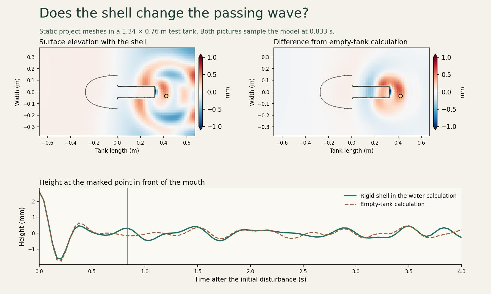

# Can the camera see water meet a fixed shell?

A small disturbance can pass the lip without producing a visible splash. The earlier optical shot let the surface wave continue mathematically through the hull. For this test, the same printed head and tail interrupt the water calculation. The body stays fixed in both images. The difference belongs to the water and the lens.

In the 1.34 × 0.76 m optical tank, the model starts with a smooth 3 mm surface rise just in front of the mouth and no initial velocity. The free surface sits 0.275 m above the bottom. No pump fires and no second hull is released. The two calculations start from the same bell-shaped profile, with its mean removed over their respective wet surfaces so they add no net volume. At the finest grid their starting heights at shared surface nodes differ by at most 0.00043 mm.

The marked point is at (0.420, −0.035) m in the optical tank coordinates. The largest difference in its first 1.5 seconds occurs at 0.833 s. Depending on grid spacing, it ranges from 0.41 to 0.49 mm. The point beside the flank at (0.20, −0.20) m differs by 0.15–0.18 mm. A point near the opposite end at (−0.52, −0.20) m differs by about 0.05–0.06 mm. These describe differences between calculations. No water in a gallery was measured. [Three probe traces](hull-wave-probes.csv)

## What meets the water in the model

Both source STLs are registered to the docking faces and converted from millimetres to metres. Finite grid links crossing any source triangle carry zero normal volume flux. Connected water can enter openings that the grid resolves. Thin walls can block links despite being thinner than a cell. The cut links form a stepped boundary, and the grid can close small gaps. Cells entirely cut off from the exterior liquid are excluded. The position of the hull is prescribed. There is no surface pinning, viscosity, air pocket, deformation, active propulsion or moving child in this calculation.

At each step the velocity potential solves Laplace's equation in the connected volume. Sidewalls, bottom and intercepted links have zero normal flux. With surface potential φ and elevation η, surface flux gives dη/dt and dφ/dt = −gη. A velocity-Verlet step uses 1/96 s, and the lens samples every fourth step. Gravity and inertia continue the motion after the initial disturbance. The model omits surface tension and specialises in small gravity waves. Craig and Sulem give a primary account of the free-surface potential formulation. The grid and solver here are a separate linear approximation. [Craig and Sulem, 1993](https://doi.org/10.1006/jcph.1993.1164) · [Engsig-Karup, Bingham and Lindberg, 2009](https://orbit.dtu.dk/en/publications/an-efficient-flexible-order-model-for-3d-nonlinear-water-waves/)

| Grid, x × y × z | Blocked links | Largest mouth probe difference, first 1.5 s | Time of that sample |
|---|---:|---:|---:|
| 54 × 31 × 14 | 1,715 | 0.491 mm | 0.833 s |
| 80 × 46 × 20 | 3,636 | 0.407 mm | 0.833 s |
| 96 × 54 × 23 | 5,459 | 0.468 mm | 0.833 s |

The magnitude does not converge monotonically across these grids. The four-second enclosed-volume residual on the finest fixed-hull run stayed below 7 × 10⁻¹⁹ m³. Sampled mechanical energy varied by at most 0.43% relative to its initial value. An independent empty-tank test initiated the first longitudinal cosine mode. At 80 × 46 × 20 the fitted angular frequency was 3.61492 rad/s, compared with 3.61471 rad/s from the finite-depth dispersion relation. That check concerns a smooth empty-tank mode. It does not establish the accuracy of a particular slot flow.

## A controlled picture

The first matched frame used the 72 mm camera and the raised 0.82 m cross-light. At 0.50 s the clearest image difference was among the upper cuts at the mouth. A 45-pixel-square neighbourhood around (701, 179) in the 960 × 540 image averaged 9.85 display-code levels of absolute RGB difference. Across the full image the mean was 0.35/255. Both shots used 48 samples, the same denoising process, materials and physical geometry. Only the height field changed. The picture includes simulated lighting and sampling noise.

The next shot uses a 118 mm model lens at f/11 from the same camera position. It is aimed at the grooves so a visitor can watch the same edge across time. Put the actual overhead recording on the main gallery wall. In rehearsal, compare this small numerical effect at the seated distance before giving a simulation its own display. A camera can miss a change that is present in the calculation.

[Flow solver](../production/solid_waves.py) · [Plot and probe sampling](../production/plot_wave_control.py) · [Camera and water mesh](../production/rim_wave.py)

To reproduce the finest pair, run the solver once with each value of --case, hull and empty, using --nx 96 --ny 54 --nz 23. Supply the repository simulator/simple/print directory and an output NPZ filename. The optical renderer reads that file through BNM_WAVE_RESULT. BNM_GROOVE_CAMERA=1 selects the closer lens, BNM_CROSS_HEIGHT=0.82 the raised strip. The earlier dispersive rush remains reproducible with its original field.

The moving comparison uses 96 consecutive 768 × 432 pictures for the fixed-hull field and 48 for its empty-water control. Render both at 24 fps with BNM_SCALE=80, BNM_SAMPLES=32 and the closer camera. After denoising, use [the film assembly](../production/hull_wave_movie.py). Its opening is the four-second fixed-shell passage. The second half compares matched views and crops over a two-second interval repeated twice. The first paired layout was checked while the remaining frames rendered.

### Looking at the delivered take

In the [eight-second film](../media/hull-water-study.mp4), the spacing of the submerged grooves appears to change although the printed geometry stays rigid. The shell-field render produces more short-term variation along this lip than the empty-field control. Across the first 48 denoised 768 × 432 source pictures, the mean absolute luma change between successive images in the 100 × 90 patch beginning at (425,113) is 2.109 code levels with the solid boundary and 1.282 without it. In the 100 × 42 patch beginning at (50,42), on the static upper shell, the same values are 0.070 and 0.072. These are display-picture differences. Their size depends on lighting, viewing angle, raster resolution and denoising.

A four-frame [decoded review](hull-wave-frames.jpg) covers both camera layouts and the deliberately repeated comparison time. The [render ledger](hull-wave-frames.csv) records all 144 optical pictures before and after denoising. The wet view completed at 06:39:53 UTC. The empty-field control completed earlier at 06:22:45 UTC. The control keeps the optical model of the shell in the frame. Only the water field supplied to the renderer changes.
